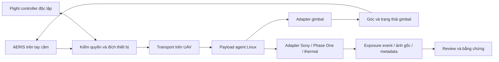

# AERIS: cấu hình tham chiếu cho sản phẩm UAV tương lai

21/10/2026 · Nghiên cứu và đề xuất R&D · **Chưa phải BOM mua hàng hoặc cấu hình đã nghiệm thu phần cứng**

Đề xuất của tôi là phát triển **một nền AERIS, nhiều cấu hình UAV/payload**, lấy chất lượng thao tác và nhiệm vụ làm mốc. Không cần buộc thiết kế mới vào BOM Hera hiện tại. Vẫn giữ riêng sự thật về phần mềm hiện có: thiết kế được một chức năng không có nghĩa là camera, radio hoặc tay cầm thật đã được kiểm đạt.

Hướng nghiên cứu 2027–2029 dưới đây là giả định lập kế hoạch của dự án, không phải dự báo hãng sẽ phát hành chip hoặc camera cụ thể. Tôi sử dụng linh kiện đang có tài liệu công khai để dựng điểm xuất phát, sau đó dành đường nâng cấp bằng contract có phiên bản.

## 1. Cấu hình nên chọn làm điểm xuất phát

| Phần hệ thống | Cấu hình tham chiếu đề xuất | Lý do và giới hạn |
|---|---|---|
| Autopilot | FC độc lập lớp FMUv6X; ArduPilot trước. ARKV6X hoặc Pixhawk6X là ứng viên bench | Tách ổn định bay/failsafe khỏi video, SDK và AI. Board, hw revision, firmware và tham số phải được qualify riêng; không suy board mới tương đương firmware Hera. |
| Payload khảo sát đầu tiên | Sony ILX-LR1 + Gremsy Pixy LR bản standard, chọn lens cụ thể | Có SDK Sony và tài liệu tích hợp Pixy/Cube/Pixhawk công khai. Chọn một đường triển khai thật trước khi mở rộng nhiều hãng. Không trộn standard, S-Port V2 và two-axis. |
| Máy tính nhiệm vụ trên UAV | Linux ARM64; Orin NX16GB, bắt đầu mode module25W khi cần nhiều pipeline/AI | Đây là đề xuất engineering. Nếu payload đã encode/xử lý đủ, gateway nhẹ hơn được ưu tiên sau phép đo. Tổng công suất gồm carrier/SSD/switch/camera/radio, không phải25W. |
| Kết nối trên UAV | USB3 + mạng payload1GbE; dự phòng2.5GbE theo tải đo | Không buộc bus mission-computer mới vào cổng100Mbps của FC. C2, media và evidence có queue/budget riêng. Tốc độ mạng nội bộ không được coi là tốc độ RF. |
| Bộ điều khiển thế hệ mới | Android, RAM16GB làm baseline, option32GB; storage256–512GB; panel8–10in, 1920×1200-class | Mục tiêu mới, không phải thay đổi profile HeraHub hiện có. Quan trọng là hardware decode, input, nhiệt và UX đo được; brightness không dùng làm nút chặn nghiên cứu phần mềm. |
| Đầu ra thao tác | Một feed chính1080p30 + IR/PiP; hai operator; observer riêng | Full-resolution image lưu trên UAV, preview thích ứng qua link. Không thiết kế mọi feed lớn đều phát xuống mọi thiết bị cùng bitrate. |
| Lưu trữ trên UAV | NVMe1TB ban đầu; option2TB với RAW + EO/IR | Dung lượng cuối theo số ảnh/giây, kích thước file thật và thời lượng. Có reserve, integrity và xuất gói theo luồng. |
| Định vị ảnh | Exposure event/trigger được đối chiếu GNSS/PPS; sidecar và ảnh gốc có SHA | Chụp ở đâu được xác định tại lúc exposure, không phải lúc download. Giữ datum, lever-arm, clock-domain và uncertainty. |

ARK xác nhận ARKV6X có thể chạy ArduPilot; Holybro công bố Ethernet100Mbps của Pixhawk6X. Đây là thông tin hãng, chưa là kiểm tương thích Hera. [ARKV6X](https://docs.arkelectron.com/products/flight-controller/arkv6x), [Pixhawk6X](https://docs.holybro.com/autopilot/pixhawk-6x/technical-specification).

Sony liệt kê ILX-LR1 trong Camera Remote SDK và có Linux ARM host. Phase One SDK cũng liệt kê Linux ARM64. Vì vậy tôi đề xuất đặt driver camera trên Linux ở UAV, còn Android gửi ý định thao tác và nhận phản hồi. Không mặc định SDK máy tính chạy trực tiếp trên Android. [Sony SDK](https://support.d-imaging.sony.co.jp/app/sdk/en/index.html), [Phase One SDK](https://developer.phaseone.com/sdk/index.html).

Orin NX có nhiều power mode;40W thuộc cấu hình Super có điều kiện flash/carrier. Không lấy TOPS ở mode cao để hứa hiệu suất ở25W. Qualcomm IQ9075 là phương án cần nghiên cứu thêm, chưa đủ snapshot nội dung để chốt BSP/codec/power; không coi là Android thay thế QCS8550 ngay. Thor dành nhánh ground/heavy-platform nếu workload chứng minh cần thiết. [NVIDIA power guide](https://docs.nvidia.com/jetson/archives/r39.2/DeveloperGuide/SD/PlatformPowerAndPerformance/JetsonOrinNanoSeriesJetsonOrinNxSeriesAndJetsonAgxOrinSeries.html), [Jetson Thor](https://www.nvidia.com/en-us/autonomous-machines/embedded-systems/jetson-thor/).

## 2. Ba cấu hình sản phẩm

**R1 · Survey/Mapping:** Sony ILX-LR1, Pixy LR standard và một lens được chốt calibration. Camera không bắt buộc gắn cứng: gimbal được phép, nhưng tiêu cự, intrinsics, tư thế chụp và pose/time phải được kiểm soát. Chế độ nadir/oblique, exposure, blur, overlap, tốc độ và trigger phải nằm trong profile nhiệm vụ. Thay lens/zoom làm mất hiệu lực calibration cũ nếu chưa có profile phù hợp.

Pixy LR được hãng thiết kế cho ILX-LR1 và có đường USB3; guide Airpixel ENTIRE minh họa tích hợp với Cube/Pixhawk. Chọn direct SDK hoặc topology Airpixel theo thử bench, không ghép tất cả vào chỉ để tăng số thành phần. Tài liệu này giúp bắt đầu nhanh, không chứng minh AERIS đã điều khiển thiết bị đó. [Pixy LR](https://gremsy.com/products/pixy-lr), [guide tích hợp](https://docs.gremsy.com/gimbals/pixy-lr/airpixel-entire-set-installation-for-cube-pilot-pixhawk).

**R2 · Utility Inspection:** Phase One P3 phiên bản MAVLink, chọn đúng camera/lens/gimbal/mount; thêm EO/IR riêng, hai operator độc lập. iXM-GS120 là option global shutter cao cấp. Các camera Phase One sẵn có của khách hàng phải định danh từng model/firmware/mount; không mặc định bộ đang dùng trên DJI lắp nguyên sang Hera. Không đồng nhất mọi Phase One với global shutter: P3 hiện có các cấu hình camera khác nhau. [P3](https://www.phaseone.com/solutions/geospatial-solutions/uav-cameras/p3/), [iXM-GS120](https://www.phaseone.com/solutions/geospatial-solutions/components/ixm-gs120/).

Gremsy VIO F1 là ứng viên EO/IR tích hợp ban đầu: có MAVLink, RTSP và thermal radiometric lớp640. Nếu tự thiết kế payload gọn, FLIR Hadron640R+ là hướng OEM khác, còn640+ non-radiometric không thay thế được phép đo nhiệt. OEM module còn cần cơ khí/gimbal, nguồn, driver và calibration. [VIO](https://gremsy.com/products/vio), [Hadron family](https://www.oem.flir.com/products/hadron-640/).

**R3 · Advanced/AI:** cùng nền điều khiển, thêm sensor fusion, LiDAR/corona, kiểm tra tự động có giám sát và simulator được hiệu chuẩn. Bốn endpoint payload là mục tiêu mở rộng logic; không suy mọi UAV đều mang đồng thời bốn payload nặng. Flight controller tiếp tục chịu trách nhiệm bay; AI hỗ trợ lập nhiệm vụ, phát hiện/chọn ảnh, chẩn đoán và đề nghị thao tác trong phạm vi quyền.

Với thermal flagship, tôi đặt mục tiêu nghiên cứu **native≥1280×1024 có radiometry**. DJI đã công bố H30T native1280×1024, nên riêng640×512 không đủ để gọi là ưu việt về độ phân giải. Tuy nhiên chưa tìm/qualify được module non-DJI tương ứng có SDK phù hợp trong lượt này: để `null`, không bịa một lựa chọn. Chất lượng thực vẫn phải xét optics, NETD, dải đo, calibration và task của khách hàng. [DJI H30 series](https://www.dji.com/support/product/zenmuse-h30-series).

## 3. Phần mềm điều khiển một gimbal/camera sẽ hoạt động thế nào?

Ví dụ kỹ sư xoay wheel: AERIS kiểm operator đang sở hữu gimbal nào, đổi thao tác thành góc hoặc tốc độ góc đúng frame, gửi qua adapter đã qualify rồi hiển thị trạng thái nhận được. Nút chụp gửi lệnh tới camera cụ thể; trạng thái “đã có ảnh” chỉ xuất hiện khi có capture/file evidence phù hợp. Đổi sang xem camera khác không tự chuyển quyền lái hoặc quyền gimbal.

Sony có thể đi qua SDK hoặc PTP được hỗ trợ theo model; Phase One có SDK/P3 interface riêng; thermal cần phân biệt video màu và dữ liệu đo nhiệt. Contract dùng chung mô tả capability; adapter thực hiện phần khác nhau của từng hãng. Chuẩn MAVLink giúp discovery/routing/ownership/time-sync, không tạo ra một driver vật lý phổ quát. [Sony PTP](https://support.d-imaging.sony.co.jp/app/cameraremotecommand/en/index.html?id=portal), [Camera protocol](https://mavlink.io/en/services/camera.html), [Gimbal v2](https://mavlink.io/en/services/gimbal_v2.html), [Time sync](https://mavlink.io/en/services/timesync.html).

Stream từ payload có thể là RTSP; gateway chuyển/gửi tới Android và các observer bằng pipeline phù hợp, WebRTC là một ứng viên. Ưu tiên hardware encode/decode và tái sử dụng bitstream khi codec cho phép; chỉ thêm SFU/relay theo phép đo fanout. Starlink/5G là phương án backhaul/observer, không mặc định là đường manual-control thay thế radio. [GStreamer WebRTC](https://gstreamer.freedesktop.org/documentation/webrtc/index.html), [Doodle Labs radio candidates](https://doodlelabs.com/products/).

## 4. Mốc chất lượng phải đo

Các số sau là **mục tiêu R&D ban đầu**, chưa phải khả năng đã đạt:

- Video1080p30: p95 photon-to-photon≤200ms, p99≤350ms trên topology RF được chốt; phải đo từ cảnh camera tới màn hình, không dùng12–20ms synthetic canvas của BIG02 thay thế.
- Hai operator và ba observer: kiểm tải đồng thời, tranh chấp quyền, mất link, restart, loss/burst và fallback; không tự khôi phục quyền.
- Gắn định vị ảnh: targettime-budget5ms tương ứng0,10m riêng thành phần thời gian ở20m/s; độ chính xác tổng thể còn GNSS/pose/calibration/datum. Không hứa mapping10cm chỉ từ phép nhân này.
- Chạy60phút ở ambient35°C trong lab: UI/media/C2 không vỡ budget, kiểm RAM/nhiệt/SSD/power; sau đó mới mở rộng môi trường và endurance.
- Input cảm ứng/joystick/phím: UI60Hz, hit target≥48dp, icon-state đúng, popup/safe-area/theme đều qua QA; blur glass có contrast/fallback, không đánh đổi khả năng đọc ngoài trời.

Chi tiết12 yêu cầu, phép đo độc lập, fault injection, băng thông, điện và dự toán lưu trữ ở [ACCEPTANCE.md](../planning/future-rd-20261021/ACCEPTANCE.md). Đây là budget đề xuất có thể sửa bằng version và căn cứ đo, không sửa hồi tố để biến run cũ thành PASS.

## 5. Tiếp thu vào hiện trạng AERIS

| Đã có làm nền | Chưa được chứng minh | Tác động lên kế hoạch |
|---|---|---|
| Native cockpit, mission/preflight/review, journal, quyền hai operator, routing nhiều payload và các run ArduPilot SITL trong phạm vi từng bản | Build hiện hành trên Xiaomi, input HeraHub thật, camera/gimbal vật lý và SDK integration | Giữ contract và hồ sơ hiện có; nối dọc một cấu hình thật để kiểm thay vì tạo thêm demo rời. |
| BIG02 có synthetic RGB/IR, lỗi link và ảnh tổng hợp + sidecar kiểm hash | Camera-to-display latency thật, fanout nhiều thiết bị, radiometry, exposure/GNSS hardware clock | Kế thừa harness; thay nguồn tổng hợp bằng adapter thực và đo từng chặng. Không chuyển nhãn synthetic thành real. |
| BOM/spec Hera/HeraHub và contract MCU nội bộ | Cấu hình đang lắp, wire-level MCU, calibration, khối lượng/CG/điện/nhiệt của gói mới | Tài liệu hiện hữu là baseline có provenance, không là giới hạn tương lai hoặc bằng chứng thiết bị. |
| Simulator có nhánh physics/SITL/3D | Fidelity Hera theo dữ liệu đo, âm học/RPM/sling/collision/energy toàn miền | Tiếp tục như dòng sản phẩm huấn luyện, không dùng hình đẹp thay bench và field. |

Đã đối chiếu13 tài liệu nội bộ có fingerprint, gồm các profile/BOM, HERAMCU45, CYBER65, ADR routing và báo cáo BIG01/BIG02. Không mở lại toàn bộ nghiên cứu RAGAS; nó không phải cơ sở duy nhất để đánh giá cấu hình tương lai. Mốc chính là [ma trận chất lượng](../planning/future-rd-20261021/ACCEPTANCE.md) và kết quả người dùng đạt được.

## 6. Thứ tự milestone lớn đề xuất

Đây là **roadmap overlay đề xuất**, giữ nguyên lịch sử BIG01–04 và source/candidate đang đóng băng. Không lấy nhãn hoàn tất research để đóng các gate sản phẩm.

1. **RD-A · Payload Gateway + Real Media Vertical Slice.** Trong cùng AERIS: profile → discovery → quyền → Sony/gimbal → preview → exposure/ảnh gốc → geotag/review/export. Bắt đầu contract/corpus bằng mock, rồi bench một combo R1. Harness phát cùng intent sang mock hoặc adapter thực, giữ nhãn nguồn. Dừng nếu không đọc lại được identity/trạng thái hoặc không chứng minh ảnh thuộc đúng exposure. Đầu ra là adapter có version, trace raw, manifest và12 hàng nghiệm thu đúng phạm vi, không thêm một trang demo rời.
2. **RD-B · Utility Multi-Payload.** Phase One đúng model + EO/IR, hai station độc lập, quyền per-device, video phân phối desktop/tablet/phone, calibration và thermal radiometry. Kiểm partition/reboot/revoke và file thật. Đóng hành trình inspection, không chỉ ACK camera.
3. **RD-C · Hera System Qualification.** Chọn package cơ khí/nguồn/CG/radio, input tay cầm thực, HIL → field → customer demo. Đo đêm/tầm xa/energy/reserve theo miền hoạt động.45+phút Phase One + Starlink là yêu cầu phải kiểm, không suy từ số phút bay noload. Compliance/SBOM/license/key-custody/production và ENDURE nguyên vẹn là các gate riêng.
4. **RD-D · Frontier Features.** Native1280 radiometry nếu có OEM phù hợp; LiDAR/corona, AI assistance, training physics được hiệu chuẩn, airframe khác qua cùng contract. Mỗi mở rộng có bài toán khách hàng và benchmark chống phương án đơn giản hơn, không chọn chip/model lớn chỉ vì mới.

Phần làm ngay không cần thiết bị: device descriptor/versioning, state machine quyền, mock driver exposure/file/clock, fault corpus, resource-budget calculator và contract tests tái sử dụng BIG02. Bước bench vẫn cần mẫu thiết bị cụ thể; thiết kế R&D không bị chặn bởi chưa có nó hôm nay. Không có dữ liệu đủ để hứa ngày giao thương mại hoặc chi phí BOM.

## 7. Độ tin cậy và phần chưa biết

Registry công khai gồm32 claim chọn lọc của23 thực thể, có snapshot và evidence-span, nguồn cùng hãng được gộp cùng origin để không tạo “xác nhận độc lập” giả. `tier A` ở đây nghĩa là nguồn chính thức cho lời công bố đó, **không phải AERIS đã đo đạt**. Giá, installed-Hera qualification và các tham số chưa có bằng chứng giữ `null`. H05/native1280, lựa chọn compute, Linux gateway và thứ tự tích hợp được lưu như giả thuyết có điều kiện bác bỏ riêng.

Lỗi nguồn được giữ: trang Sony product bị403/reader timeout; FLIR/Doodle có reader fallback lưu nguyên phản hồi công cụ, không giả thành HTML origin. Trang IQ9075 trả shell JavaScript; lần đọc nội dung thay thế cũng lỗi, nên không chốt các thông số chip từ shell. NVIDIA power-guide reader bổ sung điều kiện25/40W. Không hỏi vendor, tải SDK hoặc khẳng định NDAA của cả hệ thống từ chứng nhận một linh kiện.

- [Registry và claim](../research/future-rd-20261021/registry.json), [claim có dẫn chứng](../research/future-rd-20261021/claims.jsonl), [capture manifest](../research/future-rd-20261021/sources.json).
- [Cấu hình và giả thuyết máy đọc được](../planning/future-rd-20261021/reference-configs.json), [tiêu chí nghiệm thu](../planning/future-rd-20261021/ACCEPTANCE.md).
- [Phạm vi kiểm nghiên cứu và bảo toàn](../evidence/future-rd-20261021/verification01.json). Kiểm deterministic/span/SHA không thay đánh giá semantic của kỹ sư hoặc kiểm thiết bị.

Source/candidate/ENDURE/canonicalSOT được giữ chỉ đọc. Không build/cài/ký APK, chạy SITL/emulator/soak hoặc phát lệnh bay trong task nghiên cứu này. Những đường dẫn thiếu đã có từ các incident trước không được coi là đã hồi phục hoặc hiện diện liên tục chỉ vì nghiên cứu mới hoàn tất.
